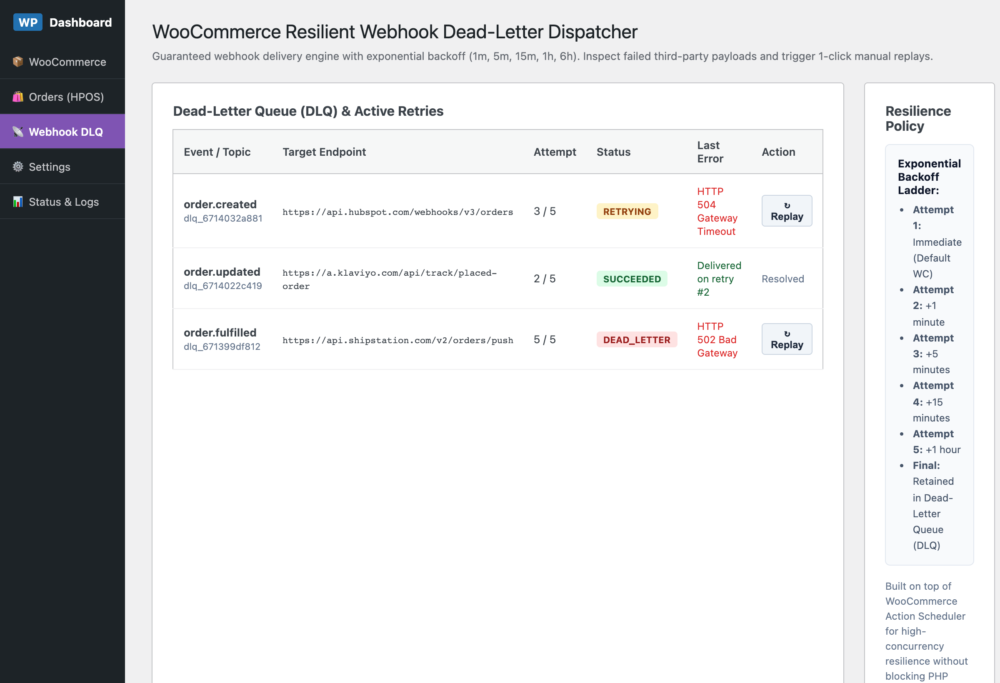
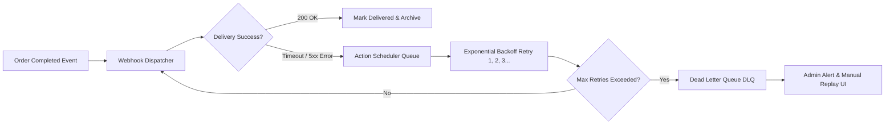

# 📡 WooCommerce Resilient Webhook Dispatcher

[🇬🇧 English](README.md) · [🇹🇷 Türkçe](README.tr.md)

[](https://github.com/harunsekmen/woo-webhook-resilience)
[](https://github.com/harunsekmen/woo-webhook-resilience/blob/main/LICENSE)
[](https://github.com/harunsekmen/woo-webhook-resilience)

> A reliable webhook delivery and retry manager for WooCommerce. Prevents dropped order notifications to external ERP, CRM, and shipping services when third-party servers experience temporary downtime.

Developed and maintained by **[Harun Sekmen](https://github.com/harunsekmen)** — E-Commerce Systems Engineer & WooCommerce Developer.

[✉️ Discuss System Integrations](mailto:sekmenwp@gmail.com) · [💼 Upwork Profile](https://www.upwork.com/freelancers/~01a7a8b58043e6e6d9) · [🔗 Main GitHub Profile](https://github.com/harunsekmen)

---

## 📸 Visual Previews & Operational Interface

### WordPress Admin Webhook Retry & Error Console
Store administrators can inspect failed webhook attempts, monitor third-party response codes, and trigger immediate manual payload replays:



---

## ⚡ The Problem It Solves

WooCommerce webhooks are essential for automatically notifying external business systems—such as warehouse fulfillment providers (ShipStation), customer platforms (Klaviyo, HubSpot), accounting software, or custom ERPs—whenever a customer places an order or updates their account.

However, native webhook deliveries can run into real-world issues:
- **Silent Delivery Drops:** If the destination server experiences a momentary network timeout, rate limit, or 500 error, the webhook delivery often fails silently.
- **Untracked Orders:** Warehouse fulfillment teams never receive the order alert, leading to delayed shipments and unhappy customers before anyone notices the error.
- **No Simple Replay:** Native WooCommerce does not offer an easy button to re-send a specific failed webhook payload without manually flipping order statuses back and forth.

**WooCommerce Resilient Webhook Dispatcher** ensures dependable communication with third-party tools. If a delivery fails, it is automatically scheduled for retry at spaced intervals and logged in a visual WP Admin dashboard, where store managers can inspect the exact payload and replay it with one click.

---


---

## 🏗️ Architecture & Dead-Letter Queue Pipeline

How outgoing order webhooks are protected with Action Scheduler exponential retry and isolated dead-letter handling:



## 🛠️ Key Architectural Features

- **Automated Retry Scheduling:** Automatically retries failed webhook deliveries at spaced intervals (e.g., +1m, +5m, +15m, +1h, +6h) before marking them for review.
- **Failed Delivery Queue:** Preserves intact JSON payloads, HTTP response codes, and error messages for complete transparency.
- **1-Click Manual Replay:** Re-send any failed notification directly from the WordPress Admin table without touching the order status.
- **Background Processing via Action Scheduler:** Retries run completely in the background without affecting store checkout performance.
- **High-Performance Order Storage (HPOS) Ready:** Built to support modern WooCommerce custom order tables and standard webhook actions.

---

## 💼 Custom Integrations & Business Automation

Need your WooCommerce store connected reliably to external APIs and services?

- **Custom ERP & CRM Integrations:** Dependable two-way syncing with HubSpot, Klaviyo, Zoho, Odoo, or proprietary ERPs.
- **Fulfillment & Shipping Connections:** Automated order handoffs to warehouse networks, local couriers, and tracking updates.
- **Accounting & Invoicing Feeds:** Automated invoice generation and tax synchronization.
- **Resilient Webhook Handlers:** Custom endpoints designed to handle third-party downtime gracefully.

📩 **Discuss your integration:** Email **[sekmenwp@gmail.com](mailto:sekmenwp@gmail.com)** or reach out via **[Upwork](https://www.upwork.com/freelancers/~01a7a8b58043e6e6d9)**.

---

## 🚀 Developer Setup & Local Testing

1. **Clone into plugins directory:**
   ```bash
   git clone https://github.com/harunsekmen/woo-webhook-resilience.git wp-content/plugins/woo-webhook-resilience
   ```

2. **Activate via WP-CLI:**
   ```bash
   wp plugin activate woo-webhook-resilience
   ```

3. **Inspect the retry console:** Go to **WooCommerce > Webhook Queue** in WordPress Admin to review delivery logs and test manual replays.

---

## 📄 License

This open-source project is licensed under the **[GNU General Public License v3.0](LICENSE)**.

